# Insert Coin

**A controller-driven, console-style game menu for [RetroArch](https://www.retroarch.com/) on Linux — with its own built-in game player.**

Pick a system, scroll through the box art, press **A** to play. No keyboard, no settings menus —
just your games, the way a console shows them.

> **Status: 0.8.2 — early release.** Tested on Linux Mint 22.3 (Cinnamon, X11) with Xbox-style and
> PlayStation controllers. It hasn't been tried on other
> setups yet, so expect rough edges and please [report them](CONTRIBUTING.md).
>
> Insert Coin currently needs a working RetroArch setup: it starts from RetroArch's playlists. Since
> 0.4.0 it can also play games itself (**Built-in player**, beta; N64 too since 0.8),
> and since 0.6 it can keep its own copies of the cores, BIOS files and box art — steps towards a
> standalone version that sets everything up for you.

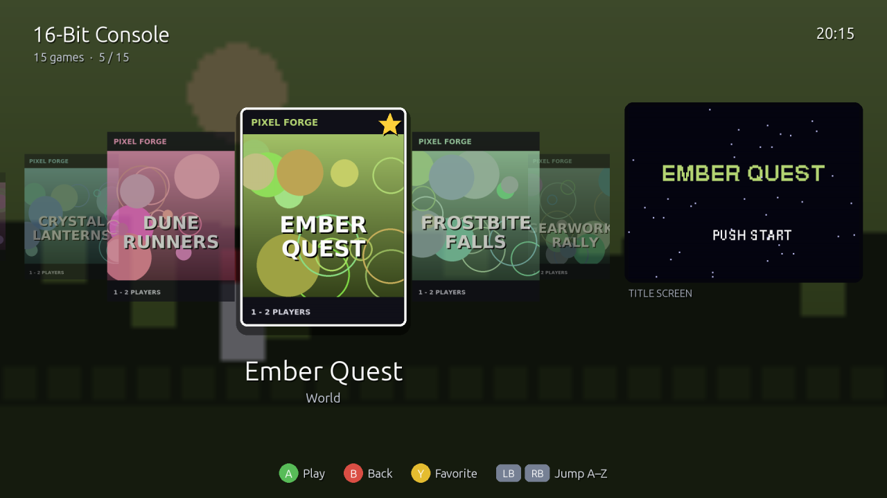

---

## Contents

- [What it is (and isn't)](#what-it-is-and-isnt)
- [Features](#features)
- [Screenshots](#screenshots)
- [Controls](#controls)
- [Built-in player (beta)](#built-in-player-beta)
- [Browser and Flash games](#browser-and-flash-games)
- [Prerequisites](#prerequisites)
- [Installation](#installation)
- [Getting artwork](#getting-artwork-sync_thumbnailspy)
- [Usage](#usage)
- [Files Insert Coin reads and writes](#files-insert-coin-reads-and-writes)
- [Troubleshooting](#troubleshooting)
- [Uninstall](#uninstall)
- [Changelog](CHANGELOG.md)
- [Credits](#credits)
- [Legal](#legal)
- [License](#license)

---

## What it is (and isn't)

Insert Coin is a **front end**, not an emulator. The emulation is done by libretro *cores* —
the same emulator plug-ins RetroArch uses. Insert Coin gives you a big-screen, controller-only
way to browse and launch games, and starts each one either in RetroArch or, if you switch it on,
in its own **built-in player**, which runs the cores directly (see
[Built-in player](#built-in-player-beta)).

It reads everything from your existing RetroArch setup — playlists, the core assigned to each
game, thumbnails, favorites and history — so **whatever already works in RetroArch works here**,
and nothing has to be set up twice. Favorites you add in Insert Coin show up in RetroArch, and
vice versa.

## Features

- **System carousel** — every RetroArch playlist as a tile with a fan of its box art.
  *Search*, *Favorites* and *Recently Played* come first. Systems get friendly names
  ("Super Nintendo" instead of "Nintendo - Super Nintendo Entertainment System"), and empty
  playlists are hidden.
- **Game carousel** — large box art in the middle, the selected game's in-game snapshot blurred
  behind it, and its title screen in a side panel. Year and publisher are shown where
  the game databases know them. Games without artwork get a clean name card.
- **Search** — the *Search* tile on the home screen, or **R3** (click the right stick) anywhere in the
  menus, opens an on-screen keyboard. Type part of a name and the matching games from every system
  appear as you type: "ninja" finds every game with that word in its name, "nin gai" narrows it
  down, and numbers match Roman numerals ("2" finds "II"). Type a year to find the games released
  that year ("1991"), a decade ("1990s"), or a company's name to find the games it developed or
  published ("capcom"; from the 4th letter, so "capc" is enough). Mix them with words of the name to narrow it down
  ("capcom 1991", "capcom street"). Years and companies come from the game databases, so
  games they don't know have none. The results open as a list you can play from, and stay on the
  Search tile.
- **Favorites** — press **Y** on any game to add or remove it.
- **Jump by letter** — **LB / RB** skip through long lists alphabetically.
- **One entry per game** — the same game copied into several folders is shown once, and its
  other versions (regions, revisions, fan translations) are grouped under one entry: press **X**
  to pick one. The best version is chosen for you: one you have a save for, then a clean dump,
  then USA / World, Europe, Japan. Prefer to see every ROM? **B** on the home screen →
  **Games: Show all**.
- **Built-in player** *(beta)* — plays games without RetroArch's window, with a simple
  menu on **Select + Start**: **Resume**, **Save state** / **Load state** (4 slots per game, each
  with a picture and the date; quitting keeps a *Continue* point for next time), **Picture**
  (sharp, smoothed or scanlines, per system), **Controls** in arcade games (which button does
  what, per game) and **Quit game**. Works for every system, N64 included.
- **Menu sounds** — retro bleeps for scrolling, selecting, going back and favorites, and Insert
  Coin's own coin-up sound when a game starts: a credit counter ticking up, then a bell. All sounds are generated by the program itself (no audio files).
  Switch them off in the menu: **B** on the home screen → **Sound: On / Off**.
- **One shortcut in every game** — **Select + Start** opens the game menu: Insert Coin's
  pause menu in the built-in player, or RetroArch's *Quick Menu* (Resume, save states,
  Close Content) in RetroArch.
- **Works with any controller** — Xbox, PlayStation and Nintendo Switch pads are recognised
  automatically, and the on-screen button hints match the controller in your hand (✕ ○ △ □ on
  PlayStation, A B X Y on Xbox and Switch, key caps on the keyboard). They switch the moment you
  plug in another pad, and pads swapped during a game are picked up. Unrecognised pads get a
  one-time set-up screen.
- **Start on login** — optionally boot straight into the game menu, like turning on a console.
- **Smooth on big screens** — renders at 1080p and is scaled by the GPU, so it stays fluid on 4K
  displays. Artwork loads in the background while you scroll.

## Screenshots

| | |
|---|---|
| 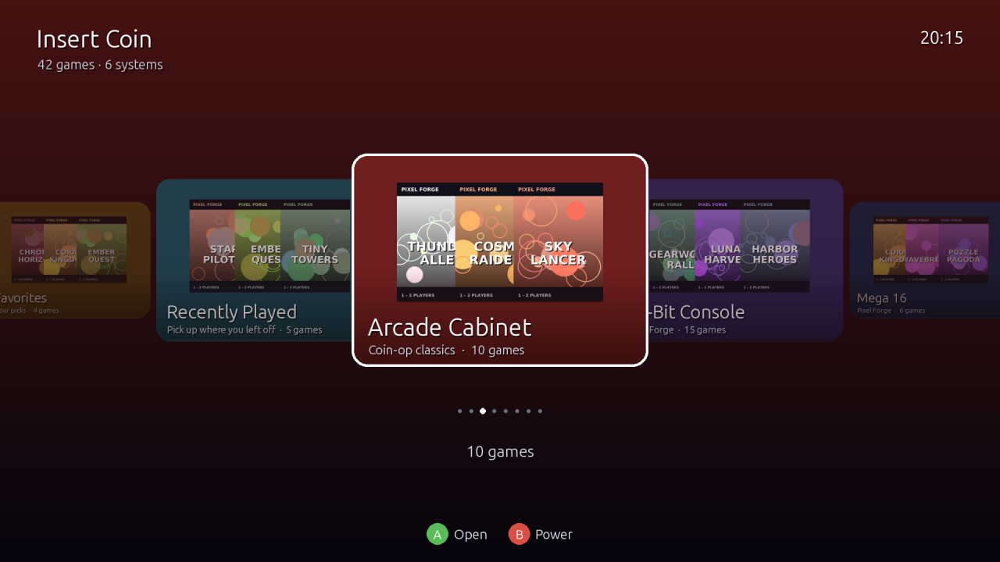 | 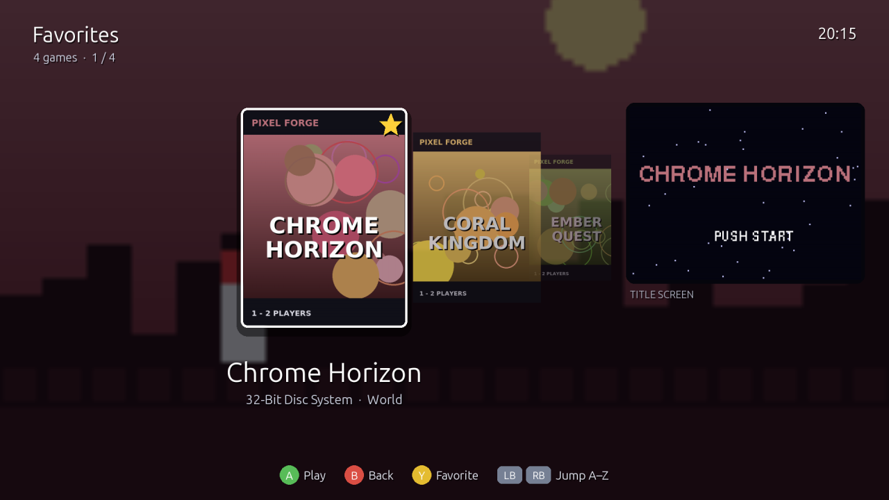 |
| **Home** — every system, plus Search, Favorites and Recently Played | **Favorites** — press Y on any game |
| 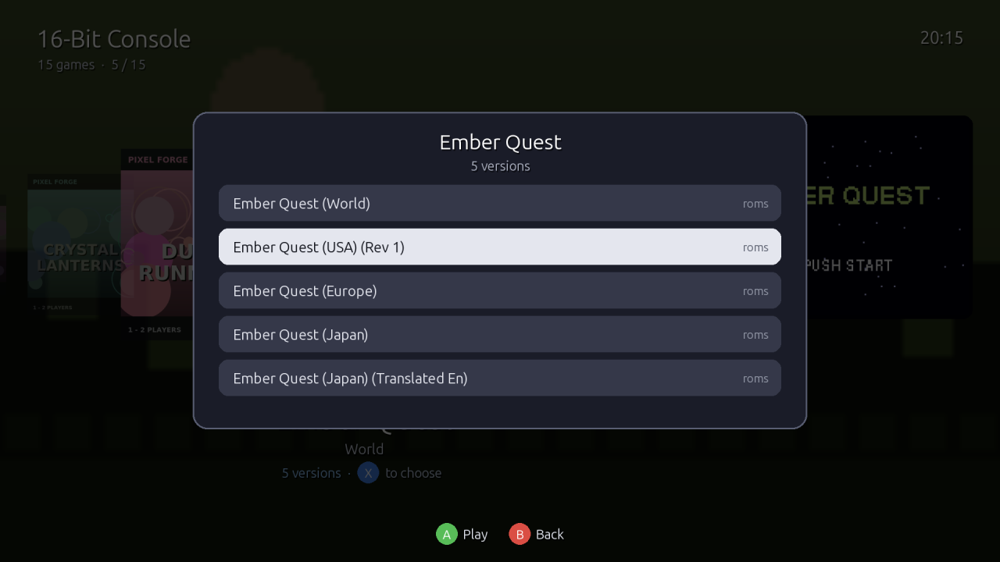 | 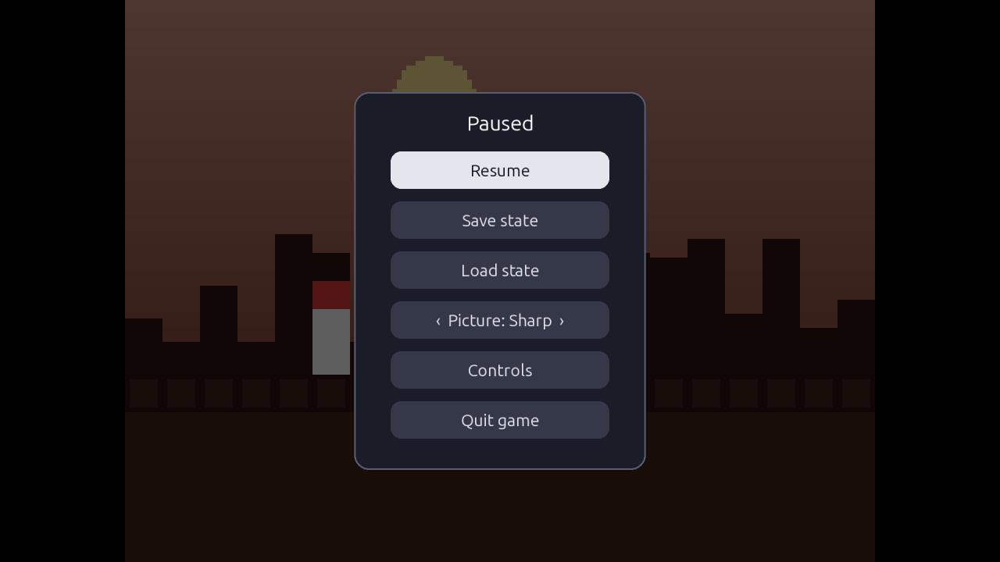 |
| **Versions** — X on a game with more than one | **Game menu** — Select + Start in the built-in player |
| 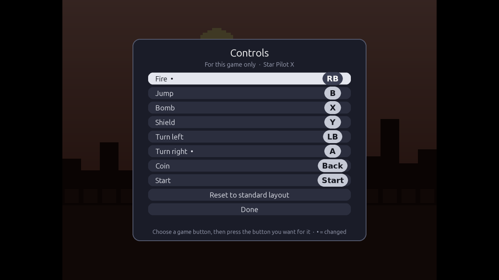 | 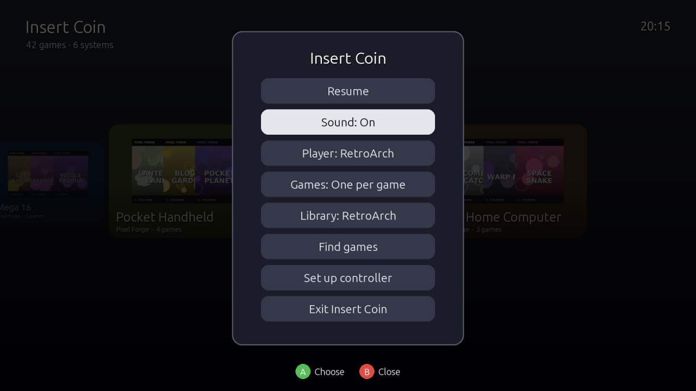 |
| **Controls** — this game's buttons, in the built-in player | **Menu** — B on the home screen |
| 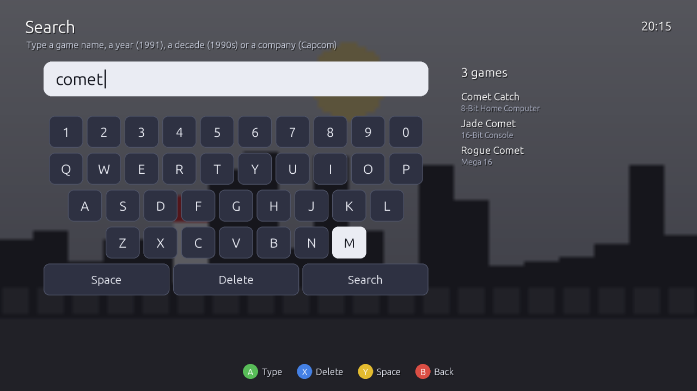 | 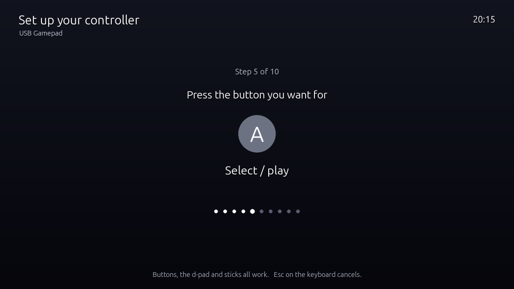 |
| **Search** — R3, or the Search tile on the home screen | **Controller set-up** — for pads that aren't recognised |
| 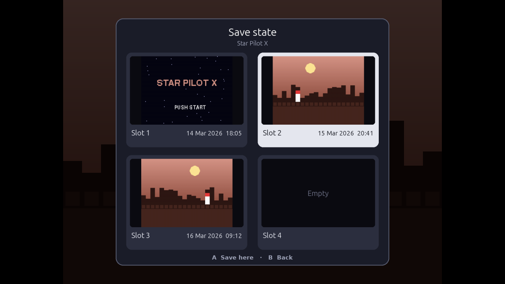 | |
| **Save state** — 4 slots per game, in the built-in player | |

Button hints follow the controller in your hand — Xbox, PlayStation, Switch / SNES-style, or keyboard:


*All games and artwork shown are fictional, generated by [`docs/make_screenshots.py`](docs/make_screenshots.py) — no real box art or game collection is used. Run it to regenerate the screenshots after UI changes.*

## Controls

| Controller (Xbox layout) | Keyboard | Action |
|---|---|---|
| D-pad / left stick | Arrow keys | Move · up/down skips 10 games |
| **A** or Start | Enter | Open a system · play a game |
| **B** or Back | Esc / Backspace | Back · on the home screen: the menu (see below) |
| **Y** | F | Add / remove favorite |
| **X** | V | Versions — choose a region, revision or translation (games with more than one) |
| **LB / RB** | Page Up / Page Down | Previous / next letter |
| **R3** (click the right stick) | / | Search |

**On the search screen:** the D-pad or left stick moves over the keyboard, **A** types a letter,
**X** deletes one, **Y** adds a space, **Start** (or the on-screen *Search* key) shows the games
found, and **B** goes back. With a keyboard, just type: Backspace deletes, Enter searches, Esc goes
back. From the results, **B** returns to the keyboard with your words still there.

The games found are listed beside the keyboard as you type. Press **right** at the keyboard's
right edge to move onto that list: up and down choose a game, **LB / RB** page through it, **A**
plays the chosen game, **Y** adds it to (or removes it from) Favorites (a star marks your favorites in
the list), **Start** opens it in the full results list (box art, versions), and **left** or **B** goes
back to the keyboard.

**The menu** (**B** on the home screen):

| Item | What it does |
|---|---|
| **Resume** | Close the menu |
| **Sound: On / Off** | Menu sounds |
| **Player: RetroArch / Built-in (beta)** | Which program plays your games — see [Built-in player](#built-in-player-beta) |
| **Games: One per game / Show all** | Group copies and versions of a game into one entry, or list every ROM |
| **Library: RetroArch / Insert Coin (beta)** | Where the list of games comes from: RetroArch's playlists, or Insert Coin's own library. The first time you choose Insert Coin, it copies your RetroArch playlists into its own library (a second or so); after that it reads its own copy. Same games, versions and box art either way. Insert Coin's library keeps its own Favorites and Recently Played too (copied from RetroArch's the first time), and every change is also written to RetroArch's, so switching back shows the same lists. If Insert Coin's library can't be read, it shows RetroArch's playlists and says so. Without RetroArch, Insert Coin's own library is used (see [Without RetroArch](#without-retroarch)) |
| **Find games** | Run the setup again: look for folders with games and add what's new (see [Setting up](#setting-up-first-run)) |
| **Set up controller** | Redo the button set-up for an unrecognised pad |
| **Exit Insert Coin** | Close Insert Coin |

**While a game is running:**

| Controller | Keyboard | Action |
|---|---|---|
| **Select + Start** | Esc *(built-in player)* | The game menu. Built-in player: **Resume**, **Save state**, **Load state**, **Picture** (sharp / smoothed / scanlines), **Controls** (arcade games: this game's buttons) or **Quit game**. RetroArch: its *Quick Menu* — Resume, save/load state, settings, and **Close Content** to return to Insert Coin |
| — | Tab *(arcade games, MAME cores)* | MAME's own menu, as in MAME32: *Input (this game)* sets the buttons for that game, dip switches, and more |

The table uses Xbox names; Insert Coin shows the matching symbols for your controller:

| Action | Xbox | PlayStation | Switch / SNES-style | Keyboard |
|---|---|---|---|---|
| Open / play | A | ✕ | A | Enter |
| Back | B | ○ | B | Esc |
| Favorite | Y | △ | Y | F |
| Previous / next letter | LB / RB | L1 / R1 | L / R | PgUp / PgDn |
| Versions | X | □ | X | V |
| Game menu | Back + Start | Select + Start (PS3) · Share + Options (PS4) · Create + Options (PS5) | Minus + Plus · Select + Start on SNES replicas | Esc |

Switch / SNES-style means controllers with the Nintendo layout: Switch Pro, Joy-Con pairs, 8BitDo pads in Switch mode, and USB SNES replicas (recognised by a name containing "SNES", "Super Nintendo" or "Super Famicom", or as the iBuffalo Classic pad). Nintendo puts A on the right and B at the bottom, and Insert Coin follows the printed labels, so **A** always selects — on replicas too, even though SDL reports their buttons by position. A replica that isn't recognised this way uses Xbox positions: the bottom button selects.

### Controllers

- **Recognised automatically:** any controller SDL knows — Xbox 360/One/Series, PlayStation 3/4/5,
  Switch Pro, 8BitDo, Logitech and most branded pads. The controller family is detected from its
  USB vendor, so the hints are right even when a pad has a generic name.
- **Anything else** (cheap generic USB pads, many arcade-stick encoders): press any button on it
  and Insert Coin opens **Set up your controller**. Press the button you want for each action —
  Up, Down, Left, Right, A (select), B (back), and optionally Y, LB and RB (press your new B to skip
  those). Buttons, d-pads and sticks all work; a button can't be given two jobs. The set-up is
  saved per controller model, so it happens once. To redo it: **B** on the home screen →
  **Set up controller**. Esc on the keyboard cancels.
- **In games**, RetroArch uses its own controller profiles. The built-in player uses the same
  layout as RetroArch's standard pad: the face buttons by position (bottom, right, left, top), so
  a game's "jump on the bottom button" stays on the bottom button whatever pad you use. Each pad
  is a player, in the order it was connected (playing two at once hasn't been tested yet). On the keyboard: arrows,
  Z / X / A / S (bottom / right / left / top), Q / W (shoulders), Enter (Start), Right Shift (Select).

## Built-in player (beta)

Insert Coin can play games itself, without starting RetroArch. Turn it on with **B** on the home
screen → **Player: Built-in (beta)**; switch back to **Player: RetroArch** at any time. Without RetroArch
installed it is always on.

- **What it is:** a small libretro *frontend* inside Insert Coin. It loads Insert Coin's own copy
  of each core once you've run `--cores` (see [Insert Coin's own cores](#insert-coins-own-cores)),
  and otherwise the core files RetroArch uses (from `~/.config/retroarch/cores/`). It shows the picture with sharp, correctly
  proportioned pixels, plays the sound at the game's own speed, and reads your controllers.
- **Systems:** NES / Famicom, SNES, Game Boy, Game Boy Color, Game Boy Advance, Mega Drive /
  Genesis, 32X, PC Engine, Neo Geo Pocket, PlayStation, Atari 2600, arcade and Neo Geo (FinalBurn
  Neo, MAME 2003 and 2003-Plus), and **N64** (Mupen64Plus-Next). If the built-in player can't start
  a game, Insert Coin opens it in RetroArch instead.
- **N64:** its core draws on the graphics card (OpenGL 3.3, GLideN64), so the built-in player gives
  it a hidden OpenGL context and shows each finished frame like any other. It uses your RetroArch
  settings for the core (resolution, graphics plugin) from
  `~/.config/retroarch/config/Mupen64Plus-Next/Mupen64Plus-Next.opt`; a setting that needs Vulkan
  (the ParaLLEl-RDP plugin) makes the game open in RetroArch instead. The left stick is the N64's
  stick only (on other systems it also works as the d-pad), the right stick gives the C-buttons, LT
  is Z, as in RetroArch.
- **Button layouts made in RetroArch** (remap files in `~/.config/retroarch/config/remaps/`, e.g.
  swapped sticks for an N64 shooter) are used by the built-in player too, for every system — except
  for an arcade game whose layout you changed with **Controls**, where that one counts.
- **Saves:** battery saves (RPG progress, high scores) go to
  `~/.local/share/insert-coin/saves/<core>/`. The first time you play a game there, your existing
  RetroArch save for it is copied in, so you carry on where you left off. They're written every
  30 seconds and when you quit.
- **Save states:** **Select + Start** → **Save state** keeps the whole game at that moment in one of
  4 slots, shown with a picture and the date; saving over a used slot asks first. **Load state** puts
  the game back to that moment. They're kept per game in `~/.local/share/insert-coin/states/<core>/`.
  Some MAME 2003-Plus games only take a state back once their start-up is over, so loading one early
  in a game first runs the start-up out of sight (a second or two, with *Loading…* on screen); a few
  arcade games still don't take a state back at all. CPS-3 games (FB Alpha 2012) have no save states.
  Games played in RetroArch keep RetroArch's own save states.
- **Picture:** **Select + Start** → **Picture** switches between **Sharp** (crisp square pixels,
  the standard), **Smoothed** (soft edges) and **Scanlines** (dark lines between the picture's
  lines, like an old TV; on turned arcade screens they run up and down). Press left / right (or A)
  and the game behind the menu changes at once. The choice is kept for every game of that system,
  in `~/.config/insert-coin/picture.json`.
- **Continue:** when you quit a game after playing it for at least 10 seconds, Insert Coin keeps
  that moment as its *Continue point*. The next time you start the game it asks **Continue** (with
  a picture of where you were and the date), **Start over** or **Not now** (back to Insert Coin
  without starting the game); **B** means Not now too. Select + Start does nothing on this question,
  so it can't start the game by accident. Starting over or choosing Not now keeps the Continue point until
  you play and quit again. It sits beside the slots, as
  `<game>.continue.state`, and doesn't use one of the 4 slots.
- **Controls per game** *(arcade and Neo Geo)*: **Select + Start** → **Controls** lists the game's
  buttons, with the names the emulator gives them (often *Button A*, *Coin*, …). Home-console
  games don't show it: they have their own button settings in their menus.
  Choose one, then press the button you want for it on your controller; the button it replaces
  takes over the old one, so nothing is lost. A dot marks what you changed; **Reset to standard
  layout** undoes it. It's saved for that game only, in `~/.config/insert-coin/remaps/`, and works
  for every player and the keyboard.
- **Turbo buttons** *(PC Engine, NES / Famicom, Game Boy, Game Boy Color, Neo Geo Pocket)*: hold
  **LB** to press the bottom button rapidly, about 15 times a second, and **RB** for the right
  button, like the turbo switches on the PC Engine's own pad. These systems have two action buttons,
  so the shoulder buttons are free. On the PC Engine the left and top face buttons (X / Y on an Xbox
  pad, Square / Triangle on a PlayStation pad) are turbo buttons too: the left-hand ones fire II,
  the right-hand ones I. Games that need LB / RB keep them: Famicom Disk System games
  (switching disks), Game Boy Advance games (L and R), the Atari 2600 (difficulty switches), and the
  PC Engine in 6-button mode (buttons III–VI). On the keyboard, Q / W do the same.
- **Keyboard:** besides the pad keys below, the keyboard is passed on to the game, so emulators
  that use it work as they do in RetroArch — for example **Tab** opens MAME's own menu in arcade
  games, where *Input (this game)* sets buttons the way MAME32 did.
- **Emulator messages** appear in the bottom-left corner, as in RetroArch — for example the PC
  Engine core's *6-button mode selected* when **LT** (L2) switches its pad mode. Some older PC
  Engine games can't walk in 6-button mode; press LT again to switch back.
- **Settings:** each core uses the options you chose for it in RetroArch, if any; otherwise its
  defaults. BIOS files are read from Insert Coin's own BIOS folder once you've run `--bios` (see
  [BIOS files](#bios-files)), otherwise from RetroArch's `system` folder.
- **`.7z` archives** are opened with the 7-Zip program (`sudo apt install p7zip-full`); `.zip`
  needs nothing extra.
- **Not there yet:** rewind, fast-forward, shaders beyond the three picture looks, changing core options, swapping
  discs in multi-disc games, and Vulkan cores (N64's ParaLLEl-RDP plugin). Use **Player: RetroArch** for those.

## Browser and Flash games

Games that run in a web browser — your own HTML5 games, or old Flash (`.swf`) games — can have
their own playlists in Insert Coin, next to the consoles. Pick one and it opens full-screen in
Google Chrome (or Chromium, Brave, Firefox), served from a small web server that only your own
computer can reach. The browser uses its own profile in `~/.local/share/insert-coin/browser/`,
so your normal browsing, tabs and windows are untouched.

- **Quitting:** **Select + Start** (Back + Start, Share + Options…) closes the game and brings you
  back to Insert Coin. There's no pause menu here — Insert Coin can't draw over the browser — so
  use the game's own pause. On the keyboard, **Alt + F4**.
- **Controllers:** HTML5 games read the pad themselves (the browser's Gamepad API).
- **Flash games** play through [Ruffle](https://ruffle.rs), a free Flash player. Flash games only
  know the keyboard and mouse, so Insert Coin turns the pad into both: the D-pad and left stick
  are the arrow keys, and each button presses the key set for that game (`buttons`, below).
  Many Flash menus are mouse-only: the **right stick moves a pointer**, and after you've moved it
  **A clicks** — the same button that selects in Insert Coin's menus (Cross on PlayStation, the
  right-hand A on Nintendo-style pads). After a click, or as soon as you press anything else, A is
  just the game's button again. The keyboard and mouse work as well, and a few Flash screens only
  react to the real keyboard (see Troubleshooting).
- **Favorites and Recently Played** work as for any other game. Insert Coin keeps them for these
  games itself, in `~/.config/insert-coin/played.json`, since RetroArch can't open them.

**Setting up.** List the games in `~/.config/insert-coin/browser_games.json`; each playlist
appears on the home screen after the consoles:

```json
{
  "playlists": [
    {
      "name": "My Games",
      "maker": "Made at home",
      "color": [230, 90, 60],
      "games": [
        {
          "title": "Star Pilot",
          "folder": "~/Games/star-pilot",
          "start": "index.html",
          "boxart": "docs/cover.png",
          "title_screen": "docs/title.png",
          "snap": "docs/level-1.png",
          "year": "2026",
          "publisher": "Me"
        }
      ]
    },
    {
      "name": "Classic Web",
      "maker": "Flash classics",
      "games": [
        {
          "title": "Pixel Knights",
          "folder": "~/Games/flash",
          "start": "pixel_knights.swf",
          "boxart": "pixel_knights.png",
          "buttons": {"south": "X", "east": "C", "west": "Z", "start": "Space"}
        }
      ]
    }
  ]
}
```

- `folder` is served as the web site's root, and `start` is the page (or `.swf`) to open.
- Images are relative to the game's folder, or full paths. Any one of them fills in for the others.
  `year`, `publisher` and `color` are optional.
- `buttons` (Flash only) sets which key each pad button presses. Buttons: `south` (A / Cross),
  `east` (B / Circle), `west` (X / Square), `north` (Y / Triangle), `left-trigger` / `right-trigger`
  (LB / RB), `select`, `start`, `dpad-up` / `-down` / `-left` / `-right`. Keys: `Up`, `Down`,
  `Left`, `Right`, `Space`, `Enter`, `Shift`, `Ctrl`, `Alt`, `Tab`, `Escape`, `Backspace`, `A`–`Z`,
  `0`–`9`. One key per button. Without it: A = Space, B = Enter, X = Z, Y = X, Start = Enter.
  Shortcuts a game reads as typed letters (such as "P = pause") don't react to the pad; use the
  keyboard for those.

**Installing Ruffle** (only needed for Flash games): download `ruffle-…-web-selfhosted.zip` from
[Ruffle's releases](https://github.com/ruffle-rs/ruffle/releases) and unpack it into
`~/.local/share/insert-coin/ruffle/`, so that `ruffle.js` is directly inside that folder.

## Prerequisites

| Requirement | Notes |
|---|---|
| **Linux desktop** | Developed on Linux Mint 22.3 (Ubuntu 24.04 base), Cinnamon, X11. Other distributions and Wayland should work but are untested. |
| **RetroArch** | Installed as a native package so the `retroarch` command is on your `PATH` (e.g. `sudo apt install retroarch`). The Flatpak and Snap versions are not supported yet. |
| **RetroArch cores** | The cores for your systems, installed via RetroArch → *Online Updater → Core Downloader*. |
| **RetroArch playlists** | Your games scanned into playlists (RetroArch → *Import Content*). Insert Coin shows one system per playlist. |
| **A core per game** | Each playlist needs a default core (*Settings → Playlists → Manage Playlists → Default Core*), or each game its own core association. Games without a core can't be launched. |
| **Thumbnails** *(optional)* | Box art, snapshots and title screens, in Insert Coin's or RetroArch's thumbnails folder. See [Getting artwork](#getting-artwork-sync_thumbnailspy). |
| **Python 3.10+** | With the `venv` module (`python3-venv` on Debian/Ubuntu/Mint). |
| **pygame-ce** | Installed automatically in the steps below. |
| **Your own games** | Insert Coin includes **no** games, BIOS files or artwork. |

**BIOS files:** a few games need BIOS files (Neo Geo, Famicom Disk System, some Super Nintendo
games). Insert Coin doesn't provide them; `insert-coin --bios` checks which ones you have (see
[BIOS files](#bios-files)).

## Installation

### 1. Get the code

```bash
git clone https://github.com/Madmartigan1/insert-coin.git ~/insert-coin
```

### 2. Create a private Python environment with pygame-ce

```bash
sudo apt install python3-venv        # Debian / Ubuntu / Linux Mint
python3 -m venv ~/.local/share/insert-coin/venv
~/.local/share/insert-coin/venv/bin/pip install pygame-ce
```

<details>
<summary>No sudo, or <code>ensurepip</code> is missing?</summary>

Create the environment without pip and unpack the pygame-ce wheel into it directly:

```bash
python3 -m venv --without-pip ~/.local/share/insert-coin/venv
# Download the pygame-ce wheel matching your Python version (e.g. cp312 for 3.12) and
# platform (manylinux … x86_64) from https://pypi.org/project/pygame-ce/#files, then:
SITE=$(~/.local/share/insert-coin/venv/bin/python -c 'import site; print(site.getsitepackages()[0])')
unzip -q pygame_ce-*.whl -d "$SITE"
```
</details>

Check it works:

```bash
~/.local/share/insert-coin/venv/bin/python -c "import pygame; print(pygame.version.ver)"
```

### 3. Create a launcher command

```bash
cat > ~/.local/share/insert-coin/insert-coin <<'EOF'
#!/bin/bash
exec "$HOME/.local/share/insert-coin/venv/bin/python" "$HOME/insert-coin/insert_coin.py" "$@"
EOF
chmod +x ~/.local/share/insert-coin/insert-coin
```

(Adjust `$HOME/insert-coin` if you cloned somewhere else.)

Optionally, to type just `insert-coin` in a terminal, link it into a folder on your `PATH`
(`~/.local/bin` is on it in most distributions, once it exists):

```bash
mkdir -p ~/.local/bin && ln -s ~/.local/share/insert-coin/insert-coin ~/.local/bin/insert-coin
```

### 4. Add it to your applications menu

```bash
cat > ~/.local/share/applications/insert-coin.desktop <<EOF
[Desktop Entry]
Type=Application
Name=Insert Coin
Comment=Browse and play your retro games with a controller
Exec=$HOME/.local/share/insert-coin/insert-coin
Icon=input-gaming
Terminal=false
Categories=Game;
EOF
```

### 5. *(Optional)* Start on login

```bash
mkdir -p ~/.config/autostart
cp ~/.local/share/applications/insert-coin.desktop ~/.config/autostart/
```

## Getting artwork: `sync_thumbnails.py`

Insert Coin keeps box art in its own folder, `~/.local/share/insert-coin/thumbnails/`, and also reads
RetroArch's thumbnails folder: a game's picture is taken from Insert Coin's folder first, then from
RetroArch's. `sync_thumbnails.py` fills in whatever is missing for
**all** your playlists in one go, and for the games in Insert Coin's own library (such as those
added by `--scan --add`), from `thumbnails.libretro.com` — the same source RetroArch's built-in
updater uses. When that server doesn't answer, the same pictures come from the libretro-thumbnails
repositories on GitHub, which the server is built from.

- Tries the exact game name first, then a careful fuzzy match that ignores tags such as
  `(USA)` or `[!]` and prefers the same region as your copy.
- Downloads box art, snapshots and title screens.
- **Never overwrites** existing images — safe to re-run whenever you add games.
- Saves new pictures in Insert Coin's own folder; a picture either folder has counts as there.
- Needs only Python's standard library.

```bash
python3 ~/insert-coin/sync_thumbnails.py --dry   # show what would be downloaded, and roughly how much
python3 ~/insert-coin/sync_thumbnails.py         # download
```

A large collection can mean several gigabytes of images on the first run.

### Copying RetroArch's art: `--copy-art`

`insert-coin --copy-art` copies the pictures in RetroArch's thumbnails folder into Insert Coin's own,
so Insert Coin no longer needs RetroArch's. It never replaces a picture Insert Coin's folder already has
and never changes RetroArch's folder, and it checks there's enough free space first. Then it checks the
copy two ways: every picture is compared byte for byte with RetroArch's, and every game in your
library is looked up in both folders, so each game's box art, title screen and snapshot are shown to be
there. It ends with *All checks passed*, or names what differs.

## Usage

Start **Insert Coin** from your applications menu, or run:

```bash
~/.local/share/insert-coin/insert-coin
```

| Option | Effect |
|---|---|
| `--windowed` | Run in a window instead of fullscreen — games too (handy for testing next to a terminal) |
| `--setup [FOLDER]` | Set up Insert Coin in the terminal: find the folders with your games (or use the ones named), get the databases, cores and BIOS files, build the library and offer box art; see [Setting up](#setting-up-first-run) |
| `--shot DIR` | Render sample screens to PNG files in `DIR` and exit — no display needed (for testing) |
| `--bios` | Check the BIOS files the built-in player's cores can use, and give Insert Coin its own BIOS folder (a copy of RetroArch's); see below |
| `--copy-art` | Copy RetroArch's box art into Insert Coin's own art folder and check every picture and every game; see [Copying RetroArch's art](#copying-retroarchs-art---copy-art) |
| `--cores` | Copy the built-in player's emulator cores into Insert Coin's own folder (downloading any RetroArch doesn't have); see below |
| `--databases` | Download the game databases (which game a file is, its year and publisher) into Insert Coin's own folder; see [Insert Coin's own game databases](#insert-coins-own-game-databases) |
| `--scan [FOLDER]` | Look through your game folders (or the folders named) and report the games that aren't in your library yet, system by system — **changes nothing** (beta; see below) |
| `--scan --add [FOLDER]` | The same, then test-start each game found and add the ones that start to Insert Coin's own library (beta; see below). Without RetroArch, this is how a library is made: `insert-coin --scan --add ~/Games` |
| `--scan --add --retry` | The same, and give the games left out for a black screen up to 6 more starts each |
| `--help`, `-h` | List these options. An option Insert Coin doesn't know is refused with a message; it never opens the app |

### Adding new games

**With *Library: Insert Coin*** (B menu):

1. Copy the game into the folder that holds your games, beside that system's other games. Don't rename
   arcade zips: they're recognised by their set name.
2. Run `insert-coin --scan --add`. It finds the new files, test-starts each one and adds the ones that start
   (see below). Files it has seen before aren't read again, so this is quick.
3. *(Optional)* Run `sync_thumbnails.py` to get box art for them (see
   [Getting artwork](#getting-artwork-sync_thumbnailspy)).
4. Restart Insert Coin: it reads the library when it starts.

**With *Library: RetroArch*:** scan the folder in RetroArch (*Import Content → Scan Directory*), then do
steps 3 and 4.

Since 0.8 `--scan --add` test-starts and adds Nintendo 64 games too (run `--cores` first, so the N64 core is
installed).

### Setting up (first run)

When Insert Coin starts with no games, it sets itself up, all on the controller:

| | |
|---|---|
| 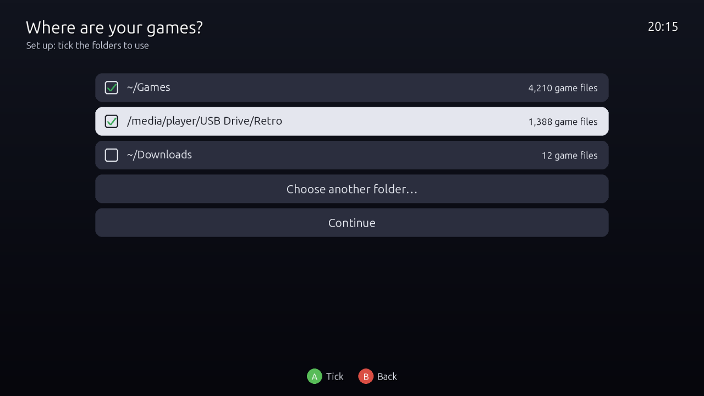 | 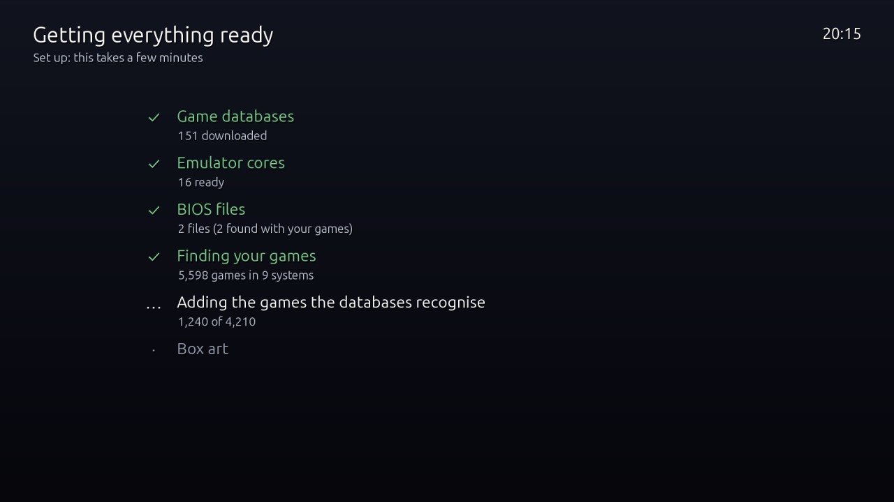 |

1. **Where are your games?** It looks through your home folder and plugged-in drives (linked folders too) for
   game files, and lists the folders that hold them, with how many game files each has. The likely ones are
   ticked; **A** ticks or unticks a folder, **Continue** goes on.
2. **Getting everything ready:** the game databases, the emulator cores and the BIOS folder (BIOS files lying
   among your games are picked up too: only known good ones, never replacing one). Then it scans the folders
   and adds every game the databases recognise by checksum, straight away.
3. **Box art:** it asks the art server what it has for your games and asks before downloading (*N pictures,
   about X MB*).
4. **Ready.** The games that need a test start (unrecognised files, arcade sets) are tested in the background
   while you play; the home screen shows how far it has got, and they appear when it's done. Box art downloads
   in the background too. Closing Insert Coin doesn't stop it.

Run it again at any time from the B menu: **Find games** (for example after copying games to a new folder).

**From the terminal:** `insert-coin --setup` does the same in the terminal: it lists the folders it found as
numbers to choose from (or name them: `insert-coin --setup ~/Games /media/me/USB`), shows each step, runs the
test starts right there and asks about box art at the end. The single steps stay available on their own:
`--databases`, `--cores`, `--bios`, `--scan --add FOLDER`, `--copy-art`.

### Without RetroArch

Insert Coin no longer needs RetroArch to be installed. When it isn't (no `retroarch` program, or no
`~/.config/retroarch/playlists`), Insert Coin starts with its own library (*Library: Insert Coin*) and plays
every game in the built-in player, and it never creates anything in RetroArch's folders. The library is made
by the [setup](#setting-up-first-run) (on the pad, or `insert-coin --setup`), or step by step:

1. `insert-coin --databases` (the game databases, so games can be recognised) and `insert-coin --cores` (the
   emulator cores).
2. `insert-coin --scan --add FOLDER`, with the folder that holds your games (several folders are fine).

On an empty library, console games the databases know by their checksum go straight in, without a test start,
because they're known good dumps; games placed only by their file type and all arcade sets are test-started as
usual. That makes the first run much quicker (for a large collection still an hour or more: arcade sets take
the longest). Later runs test everything new, as before.

### Scanning for games (beta)

`--scan` looks through the folder that holds your games (found from your library, or the folders you name) and recognises each game by
its checksum, read from the zip's index without unpacking it, and arcade games by their set name, using
the game databases (RetroArch's, and Insert Coin's own copy once you've run `--databases`). It also recognises Mega Drive `.smd` files, NES ROMs with unusual headers and Super
Nintendo ROMs with a copier header. For each system it reports how many games are already **listed**, how many
are **new** (recognised but not in your library), how many it could only place **by type** (not in the
database, such as translations and hacks), and how many are **copies** of games you already have. A file whose
type several systems use (a `.bin`) goes with the games beside it. An arcade zip whose set name no database
knows (an older or renamed set) is counted by type for the MAME list: if a test start works, it's added under
its set name (for example `pixelk2`), without box art. BIOS and
enhancement-chip files are set apart. The first scan reads every archive's index (a few minutes for a large
collection); later scans only read what changed. The full list goes to
`~/.local/share/insert-coin/scan-report.json`.

`--scan --add` then test-starts every new game and every game placed by type (copies are never added). Each
runs in the built-in player for 60 seconds of game time, without a window, sound, saves or controllers, with
Start, A and B pressed along the way; that takes a few seconds per game. A game is added if any of its frames
shows something, so games without box art or with a dark title screen still count. It is left out only if it
can't be loaded, the player stops with an error, or the screen stays black the whole time (a black screen gets a
second start, since some cores fill the console's memory with random values at power-on). FinalBurn Neo
shows its own error screen for an arcade set with files missing, so a set it reports files missing for is left
out too; it shows one for a set name it doesn't know as well, so FinalBurn Neo is only tried with set names in its
database. When these rules improve, games added by an earlier run are tested again, and taken out of the
library if they no longer pass (their files stay where they are). Arcade sets are also
tried with the other arcade cores (last of all FB Alpha 2012 CPS-3, for older CPS-3 sets), and Mega Drive games with PicoDrive when BlastEm can't start them (it
can't read `.smd` files), and Super Nintendo games with Snes9x when Mesen-S can't (some betas); the core that starts a game is remembered. Games are added to Insert Coin's
own library only (B menu → *Library: Insert Coin*); RetroArch's playlists aren't changed, and the library as it
was before is kept beside it (`library.json.pre-scan-…`). Games left out are never deleted: they're listed with
the reason in `~/.local/share/insert-coin/scan-not-added.json`. Running it again only tests what is new or changed. A
few games start only some of the time (the console's memory is random at power-on); `--scan --add --retry`
starts the games left out for a black screen again, up to 6 times each, and adds those that show something.

### BIOS files

`--bios` copies RetroArch's BIOS folder (`~/.config/retroarch/system/`) to Insert Coin's own,
`~/.local/share/insert-coin/system/`, the first time; the built-in player uses that folder from then on.
Later runs only add files RetroArch has that Insert Coin's folder lacks, and never replace one; RetroArch's
folder is never changed. It then lists, system by system, the BIOS files the built-in player's cores can
use, and whether each is there and the known good dump (by the checksums RetroArch's core information
gives). Most are optional, and the games run without them. A few games need one:

- **Neo Geo** games whose zip doesn't carry the BIOS need `fbneo/neogeo.zip`;
- **Famicom Disk System** games (`.fds`) need `disksys.rom`;
- some **Satellaview** games need `BS-X.bin`.

Super Nintendo games with a **DSP or ST01x chip** (a few racing, flying and 3D games) need the chip's
`.data.rom` and `.program.rom` files in Mesen-S, and stop at the start-up logo without them. Insert Coin reads
the chip from the game's header and, when the files aren't in the BIOS folder, runs those games in Snes9x instead,
which has the chips built in (`insert-coin --cores` installs it). With the files in the folder they stay with
Mesen-S.

Insert Coin doesn't download BIOS files (they're copyrighted): copy your own into the folder it shows. When a
Disk System game can't start for lack of its BIOS, or FinalBurn Neo reports files missing for an arcade game,
Insert Coin says so when you're back in the menu. CD systems aren't in Insert Coin yet, so their BIOS files
aren't listed.

### Insert Coin's own cores

`--cores` puts a copy of every core the built-in player runs in `~/.local/share/insert-coin/cores/`, and
the built-in player uses those copies from then on. A core RetroArch already has is copied from RetroArch's
folder, so you keep the versions you've been playing; one it doesn't have is downloaded from the libretro
buildbot (`buildbot.libretro.com`), where RetroArch gets its cores too (64-bit PCs only for now). Each copy
is test-loaded before it's used and must report the right name; one that fails is removed again and listed.
RetroArch's own folder is never changed, and RetroArch keeps using its own cores.
Running it again keeps the copies you have; to replace one, delete it and run `--cores` again. Insert Coin
doesn't ship cores itself: several don't allow commercial use, so they come from their publisher's server.

### Insert Coin's own game databases

`--databases` downloads the libretro game databases (about 50 MB, 150 files) from the libretro buildbot, the same
file RetroArch's *Update Databases* uses, into `~/.local/share/insert-coin/database/rdb/`. The download is checked
(every file must be a game database, and the main ones must be there) before it replaces an older copy, so a
failed download changes nothing; running it again gets the newest version.

When RetroArch's databases are there too, Insert Coin uses both, so nothing it knew before is lost: the scanner
recognises a game either copy knows, and a game's year and publisher come from RetroArch's copy first (newer
databases rename some games, so RetroArch's copy matches the names in RetroArch's playlists) and from Insert
Coin's copy for games RetroArch's doesn't know. On a computer without RetroArch, Insert Coin's copy is all it
needs. RetroArch's own databases are never changed.

**Tip:** close RetroArch before starting Insert Coin. Two copies of RetroArch running at once
can overwrite each other's settings.

## Files Insert Coin reads and writes

**Reads** (never modified, except where noted):

| Path | What |
|---|---|
| `~/.config/retroarch/playlists/*.lpl` | Your systems and games, and each game's core |
| `~/.config/retroarch/thumbnails/` | Box art, snapshots, title screens (after Insert Coin's own folder) |
| `~/.config/retroarch/content_history.lpl` | Recently Played |
| `~/.config/retroarch/database/rdb/*.rdb` | Year and publisher information, and (`--scan`) the checksums and arcade set names games are recognised by (together with Insert Coin's own copy, if any) |
| `~/.config/insert-coin/browser_games.json` | Your browser and Flash game playlists (optional) |

**Writes:**

| Path | When |
|---|---|
| `~/.config/retroarch/content_favorites.lpl` | When you add/remove a favorite (only while RetroArch is closed) |
| `~/.local/share/insert-coin/launch.cfg` | Each game launch: the in-game controller shortcuts, passed to RetroArch with `--appendconfig` |
| `~/.local/share/insert-coin/thumbnails/` | Box art, snapshots and title screens: new ones from `sync_thumbnails.py`, and RetroArch's after `--copy-art` |
| `~/.local/share/insert-coin/saves/` | Battery saves of games played in the built-in player |
| `~/.local/share/insert-coin/states/` | Save states of the built-in player (4 slots per game, each with a picture) |
| `~/.cache/insert-coin/meta/` | Cached year/publisher lookups |
| `~/.config/insert-coin/controllers.json` | Button set-ups for controllers that aren't recognised automatically |
| `~/.config/insert-coin/remaps/` | Button layouts you chose for single games in the built-in player (**Controls**) |
| `~/.config/insert-coin/settings.json` | Your settings: menu sounds, which player, one entry per game or show all, which library |
| `~/.local/share/insert-coin/library.json` | Insert Coin's own game library (**Library: Insert Coin**), copied from your RetroArch playlists the first time you choose it |
| `~/.local/share/insert-coin/scan-report.json` | What the last `--scan` found |
| `~/.cache/insert-coin/scan.json` | What each scanned file holds, so later scans only read what changed |
| `~/.local/share/insert-coin/system/` | Insert Coin's own BIOS folder (`--bios`), a copy of RetroArch's |
| `~/.local/share/insert-coin/cores/` | Insert Coin's own copies of the cores (`--cores`), and `cores.json`: where each came from, its version and checksum |
| `~/.local/share/insert-coin/database/` | Insert Coin's own game databases (`--databases`): `rdb/*.rdb`, and `databases.json` (where and when they were downloaded, and the download's checksum) |
| `~/.local/share/insert-coin/scan-not-added.json` | Games `--scan --add` found but didn't add, and why (nothing is deleted) |
| `~/.local/state/insert-coin/setup-status.json` | How far the setup's background run (test starts, box art) has got |
| `~/.local/state/insert-coin/setup-background.log` | What the setup's background run printed |
| `~/.cache/insert-coin/test-starts.json` | The result of each test start, so later runs only test what is new or changed |
| `~/.local/share/insert-coin/favorites.json`, `history.json` | Favorites and Recently Played for **Library: Insert Coin**, copied from RetroArch's the first time |
| `~/.config/insert-coin/played.json` | Favorites and Recently Played for browser games, and the time of each game launch (to place them in Recently Played) |
| `~/.local/share/insert-coin/browser/` | The browser profile browser games run in |
| `~/.local/state/insert-coin/browser-last.log` | The browser's output for the last browser game (`browser-previous.log`: the one before) |
| `~/.local/state/insert-coin/insert-coin.log` | A log of start-ups, game launches and how each one ended, and any errors (kept to about 1 MB) |
| `~/.local/state/insert-coin/retroarch-last.log` | RetroArch's detailed log of the last game played (`retroarch-previous.log`: the one before) |
| `~/.local/state/insert-coin/engine-last.log` | The built-in player's log of the last game it played (`engine-previous.log`: the one before) |
| `~/.config/retroarch/content_history.lpl` | Recently Played, for games played in the built-in player |

**Note:** RetroArch saves its settings when it closes, so the in-game shortcut (Select + Start
for the menu) and *Close Content quits RetroArch* (for games started from the command line only)
become part of your RetroArch configuration. You can change them in RetroArch under
*Settings → Input → Hotkeys* and *Settings → User Interface*. With `--windowed`, RetroArch
also runs in a window, and that is not saved.

## Troubleshooting

| Problem | What to try |
|---|---|
| **A system is missing** | Insert Coin hides empty playlists. Check the playlist exists in `~/.config/retroarch/playlists/` and has games. |
| **"No core is set for this game"** | Set a default core for that playlist in RetroArch (*Settings → Playlists → Manage Playlists*) or set the game's core association. |
| **"The game closed straight away"** | The game doesn't run with its assigned core, or a BIOS file is missing (`insert-coin --bios` lists them). Try it in RetroArch directly to see the error, then change the core. |
| **I see fewer games than RetroArch lists** | Copies of the same game in several folders are shown once, and versions are grouped (press **X** on a game to see them). **B** on the home screen → **Games: Show all** lists every ROM. |
| **A game behaves differently in the built-in player** | Switch to **Player: RetroArch** and compare. If it's the same there, it's the game (some fire automatically, for instance); if not, please [report it](CONTRIBUTING.md) with `engine-last.log`. |
| **No artwork** | Run `sync_thumbnails.py`. Some games — hacks, prototypes, translations — have no artwork on the server and get a name card instead. |
| **Controller does nothing** | Press a button: an unrecognised controller opens the set-up screen. If nothing happens, check the controller works in RetroArch (`retroarch --version`, Settings → Input). Keyboard controls always work. |
| **Set up a controller wrongly** | **B** on the home screen → **Set up controller** to do it again, or delete `~/.config/insert-coin/controllers.json`. |
| **Can't quit a game with the controller** | Press Select + Start together, then choose **Quit game** (built-in player) or **Close Content** (RetroArch). If that was changed in RetroArch, use your RetroArch hotkey or the Esc key. |
| **Something crashed or closed unexpectedly** | Look at `~/.local/state/insert-coin/insert-coin.log` — it records each launch and how the game ended — and at `retroarch-last.log` or `engine-last.log` next to it for the game's details. Attach both when [reporting a problem](CONTRIBUTING.md). |
| **No menu sounds** | Check **B** on the home screen shows **Sound: On**, and that your system volume is up. Without a working audio device Insert Coin simply runs silently. Game sound is handled separately and isn't affected. |
| **Sticks feel swapped in an N64 shooter** | Many N64 shooters walk with the C-buttons and aim with the stick, and RetroArch puts the C-buttons on your right stick. In the game, open RetroArch's menu (**Select + Start**) → *Controls → Port 1 Controls*, swap the Left and Right Analog entries, then *Manage Remap Files → Save Game Remap File*. It applies to that game only, in RetroArch and in the built-in player (switch to **Player: RetroArch** in the B menu to set it up). |
| **A browser game has no sound, or ignores the pad** | Press a button on the pad once the game shows: browsers only report a controller after it's used on the page. If a Flash game doesn't respond to a button, set it in `buttons` (see [Browser and Flash games](#browser-and-flash-games)). |
| **A Flash screen ignores the pad** | A few Flash screens only react to a real key held on the keyboard (for example a "Press space bar to continue" that checks the key at one moment). Use the keyboard there; it always works alongside the pad. |
| **"Flash games need Ruffle"** | Install Ruffle as described in [Browser and Flash games](#browser-and-flash-games). |
| **Stutters while scrolling the first time** | Artwork loads in the background on first view, then stays cached for the session. |

## Uninstall

```bash
rm -rf ~/.local/share/insert-coin ~/.cache/insert-coin ~/insert-coin
rm -f ~/.local/share/applications/insert-coin.desktop ~/.config/autostart/insert-coin.desktop
```

Your RetroArch setup, games, saves and favorites are not touched.

## Credits

Insert Coin stands on the work of many other people. Thank you to all of them.

**Emulator cores.** Insert Coin doesn't include any cores. The built-in player loads the libretro cores you
install (`--cores` copies them from RetroArch or downloads them from the libretro buildbot), and each keeps its
own license:

| Core | Systems | Authors | License |
|---|---|---|---|
| Mesen | NES / Famicom | M. Bibaud (Sour) | GPLv3 |
| Mesen-S | SNES / Super Famicom | M. Bibaud (Sour) | GPLv3 |
| Snes9x | SNES games with DSP / ST01x chips | Snes9x Team | Non-commercial |
| VBA-M | Game Boy, Game Boy Color, Game Boy Advance | Forgotten, VBA-M Team | GPLv2 |
| BlastEm | Mega Drive / Genesis | Mike Pavone | GPLv3 |
| PicoDrive | 32X, Mega Drive (interleaved files) | notaz, fdave, irixxxx | MAME |
| Beetle SuperGrafx | PC Engine | Mednafen Team | GPLv2 |
| Beetle NeoPop | Neo Geo Pocket | neopop_uk, Mednafen Team | GPLv2 |
| PCSX ReARMed | PlayStation | PCSX Team, notaz, Exophase | GPLv2 |
| Stella | Atari 2600 | Stephen Anthony, Bradford Mott, Eckhard Stolberg, Brian Watson | GPLv2 |
| FinalBurn Neo | Arcade, Neo Geo | Team FBNeo | Non-commercial |
| MAME 2003 / MAME 2003-Plus | Arcade | MAMEdev, MAME 2003-Plus Team | MAME (non-commercial) |
| FB Alpha 2012 CPS-3 | Arcade (CPS-3) | Team FB Alpha | Non-commercial |
| Mupen64Plus-Next | Nintendo 64 (with GLideN64 graphics) | m4xw, Hacktarux, gonetz, GLideN64 contributors, Mupen64Plus Team | GPLv2 |

**Interfaces and libraries:**
- [libretro API](https://github.com/libretro/libretro-common) (MIT, © The RetroArch team). The built-in
  player's structures and numbers follow `libretro.h`; no code is copied.
- [RetroArch](https://www.retroarch.com) (GPLv3, © The RetroArch team). Insert Coin reads its playlists,
  favorites, history, core options, button remap files (their format and numbers, see
  `insertcoin/raremap.py`) and game databases, and can launch games in it. No RetroArch code is included.
- [pygame-ce](https://github.com/pygame-community/pygame-ce) (LGPL 2.1) and [SDL](https://www.libsdl.org)
  (zlib license): window, picture, sound and controllers.
- [Khronos EGL and OpenGL](https://registry.khronos.org) function names and values, used to give N64 games a
  window-less OpenGL context through your system's graphics driver (on Linux usually
  [Mesa](https://mesa3d.org), whose `EGL_MESA_platform_surfaceless` extension makes this possible).
- [Ruffle](https://ruffle.rs) (MIT / Apache 2.0): plays Flash games.
- [7-Zip](https://www.7-zip.org) / p7zip (LGPL): reads `.7z` archives.

**Data and file formats:**
- The [libretro database](https://github.com/libretro/libretro-database) by the libretro team and its
  contributors (`.rdb` files, RetroArch's or downloaded by `--databases` from the libretro buildbot):
  checksums, years and publishers for the scanner and game info.
- The [libretro thumbnails](https://github.com/libretro-thumbnails/libretro-thumbnails) project: box art,
  title screens and snapshots downloaded by `sync_thumbnails.py` (from thumbnails.libretro.com, or from the
  project's repositories on GitHub when that server doesn't answer).
- Game file headers (iNES, the SNES cartridge and copier headers, the Super Magic Drive interleave) are read as
  described in public community documentation such as the [NESdev](https://www.nesdev.org/wiki/) and
  [SNESdev](https://snes.nesdev.org/wiki/) wikis.

## Legal

Insert Coin is an independent project and is not affiliated with or endorsed by RetroArch,
libretro, or any game or console maker. All product names and trademarks belong to their owners.

Insert Coin does not include, download or distribute games, BIOS files or copyrighted artwork.
Only use games you are legally entitled to. Thumbnails fetched by `sync_thumbnails.py` come
from the libretro thumbnail project and remain subject to their owners' rights.

## License

[MIT](LICENSE) © 2026 Aleksandar Kamber

Insert Coin uses [pygame-ce](https://github.com/pygame-community/pygame-ce), which is licensed
under the LGPL 2.1, as an installed library. The built-in player talks to emulator cores through
the MIT-licensed [libretro API](https://github.com/libretro/libretro-common); it does not include
any cores. The cores you install keep their own licenses.
