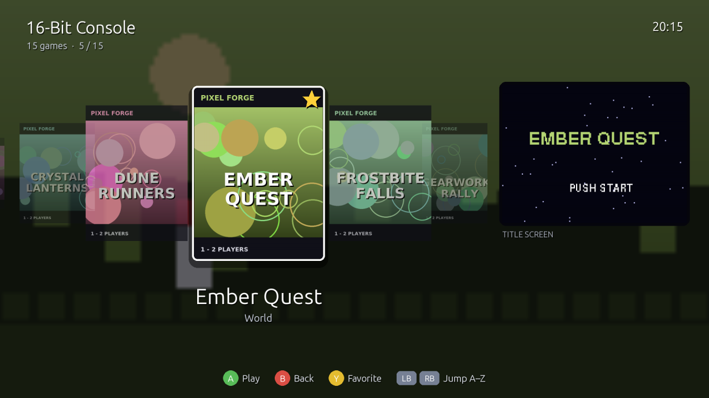
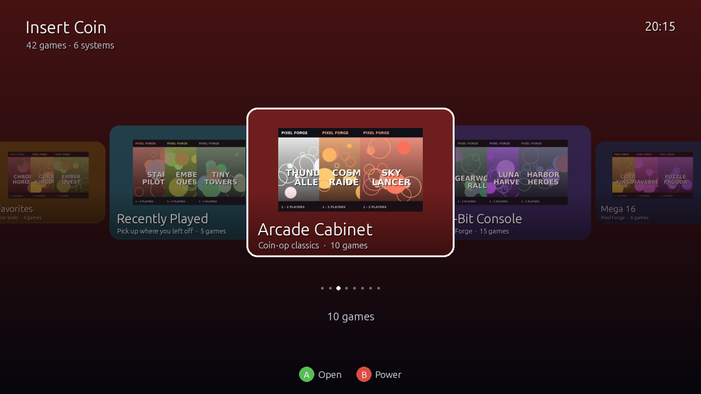
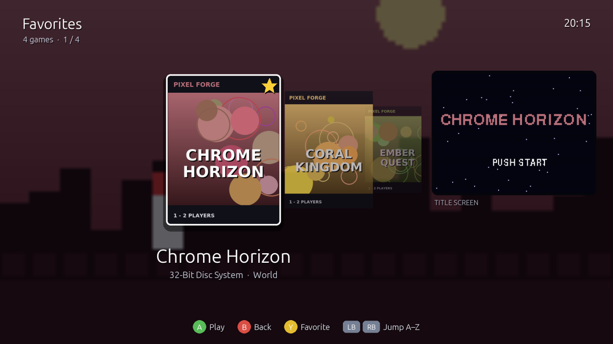
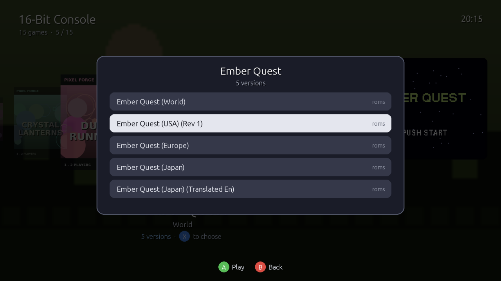
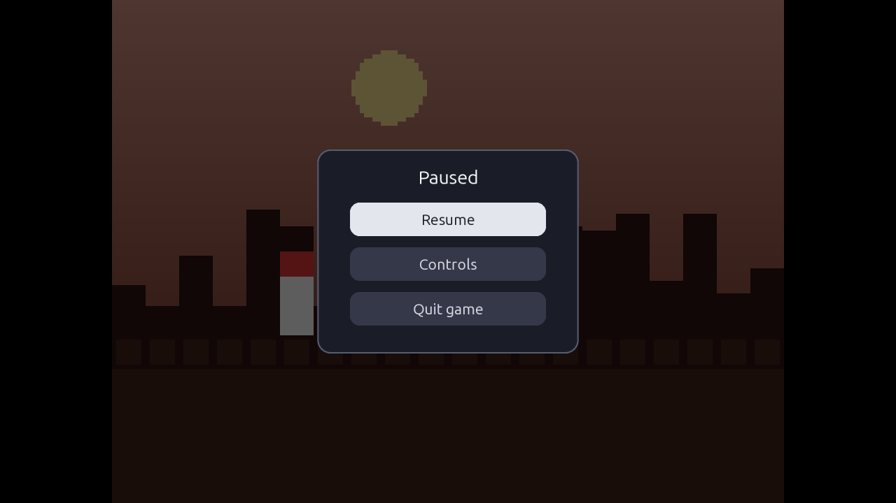
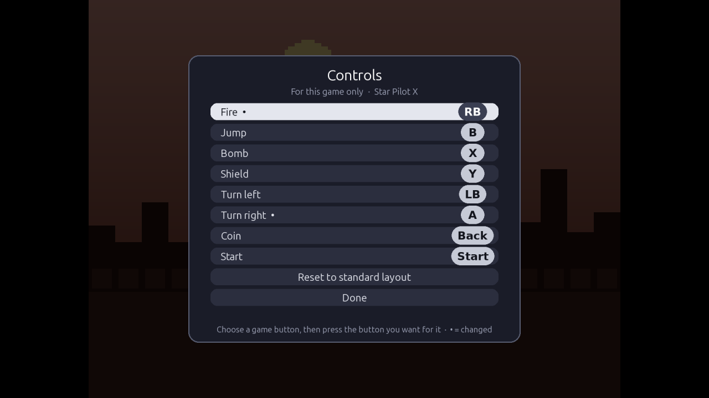
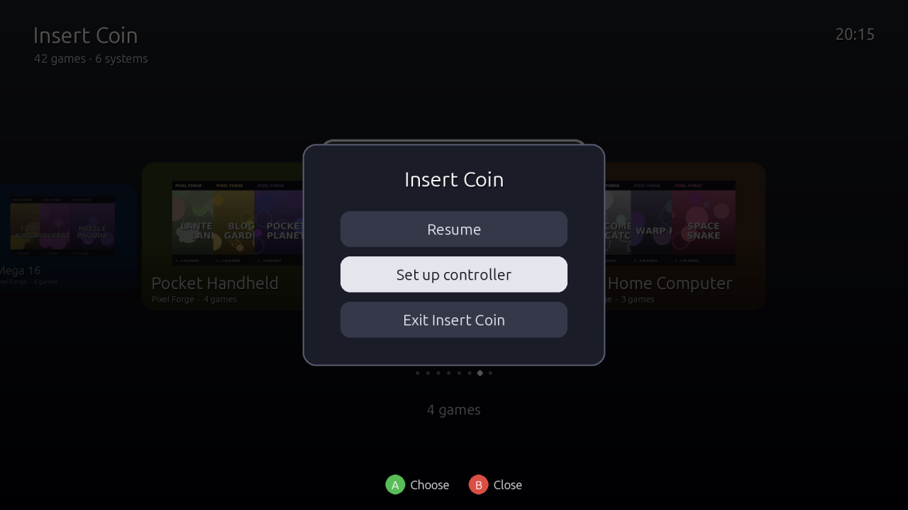
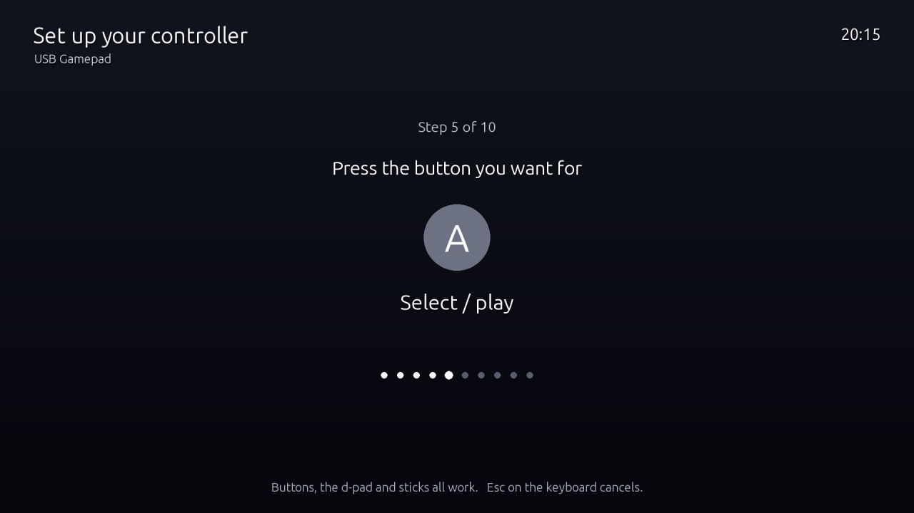

# Insert Coin

**A controller-driven, console-style game menu for [RetroArch](https://www.retroarch.com/) on Linux — with its own built-in game player.**

Pick a system, scroll through the box art, press **A** to play. No keyboard, no settings menus —
just your games, the way a console shows them.

> **Status: 0.4.3 — early release.** Tested on Linux Mint 22.3 (Cinnamon, X11) with Xbox-style and
> PlayStation controllers. It hasn't been tried on other
> setups yet, so expect rough edges and please [report them](CONTRIBUTING.md).
>
> Insert Coin currently needs a working RetroArch setup: it uses RetroArch's playlists, cores and
> artwork. Since 0.4.0 it can also play most games itself (**Built-in player**, beta) — the first
> step towards a standalone version that sets everything up for you.



---

## Contents

- [What it is (and isn't)](#what-it-is-and-isnt)
- [Features](#features)
- [Screenshots](#screenshots)
- [Controls](#controls)
- [Built-in player (beta)](#built-in-player-beta)
- [Browser and Flash games](#browser-and-flash-games)
- [Prerequisites](#prerequisites)
- [Installation](#installation)
- [Getting artwork](#getting-artwork-sync_thumbnailspy)
- [Usage](#usage)
- [Files Insert Coin reads and writes](#files-insert-coin-reads-and-writes)
- [Troubleshooting](#troubleshooting)
- [Uninstall](#uninstall)
- [Changelog](CHANGELOG.md)
- [Legal](#legal)
- [License](#license)

---

## What it is (and isn't)

Insert Coin is a **front end**, not an emulator. The emulation is done by libretro *cores* —
the same emulator plug-ins RetroArch uses. Insert Coin gives you a big-screen, controller-only
way to browse and launch games, and starts each one either in RetroArch or, if you switch it on,
in its own **built-in player**, which runs the cores directly (see
[Built-in player](#built-in-player-beta)).

It reads everything from your existing RetroArch setup — playlists, the core assigned to each
game, thumbnails, favorites and history — so **whatever already works in RetroArch works here**,
and nothing has to be set up twice. Favorites you add in Insert Coin show up in RetroArch, and
vice versa.

## Features

- **System carousel** — every RetroArch playlist as a tile with a fan of its box art.
  *Favorites* and *Recently Played* come first. Systems get friendly names
  ("Super Nintendo" instead of "Nintendo - Super Nintendo Entertainment System"), and empty
  playlists are hidden.
- **Game carousel** — large box art in the middle, the selected game's in-game snapshot blurred
  behind it, and its title screen in a side panel. Year and publisher are shown where
  RetroArch's databases know them. Games without artwork get a clean name card.
- **Favorites** — press **Y** on any game to add or remove it.
- **Jump by letter** — **LB / RB** skip through long lists alphabetically.
- **One entry per game** — the same game copied into several folders is shown once, and its
  other versions (regions, revisions, fan translations) are grouped under one entry: press **X**
  to pick one. The best version is chosen for you: one you have a save for, then a clean dump,
  then USA / World, Europe, Japan. Prefer to see every ROM? **B** on the home screen →
  **Games: Show all**.
- **Built-in player** *(beta)* — plays games without RetroArch's window, with a simple
  **Resume / Quit game** menu on **Select + Start** — plus **Controls** in arcade games, to choose
  which button does what for each game. Works for every system except N64.
- **Menu sounds** — retro bleeps for scrolling, selecting, going back and favorites, and Insert
  Coin's own coin-up sound when a game starts: a credit counter ticking up, then a bell. All sounds are generated by the program itself (no audio files).
  Switch them off in the menu: **B** on the home screen → **Sound: On / Off**.
- **One shortcut in every game** — **Select + Start** opens the game menu: Insert Coin's
  *Resume / Quit game* in the built-in player, or RetroArch's *Quick Menu* (Resume, save states,
  Close Content) in RetroArch.
- **Works with any controller** — Xbox, PlayStation and Nintendo Switch pads are recognised
  automatically, and the on-screen button hints match the controller in your hand (✕ ○ △ □ on
  PlayStation, A B X Y on Xbox and Switch, key caps on the keyboard). They switch the moment you
  plug in another pad, and pads swapped during a game are picked up. Unrecognised pads get a
  one-time set-up screen.
- **Start on login** — optionally boot straight into the game menu, like turning on a console.
- **Smooth on big screens** — renders at 1080p and is scaled by the GPU, so it stays fluid on 4K
  displays. Artwork loads in the background while you scroll.

## Screenshots

| | |
|---|---|
|  |  |
| **Home** — every system, plus Favorites and Recently Played | **Favorites** — press Y on any game |
|  |  |
| **Versions** — X on a game with more than one | **Game menu** — Select + Start in the built-in player |
|  |  |
| **Controls** — this game's buttons, in the built-in player | **Menu** — B on the home screen |
|  | |
| **Controller set-up** — for pads that aren't recognised | |

Button hints follow the controller in your hand — Xbox, PlayStation, Switch / SNES-style, or keyboard:


*All games and artwork shown are fictional, generated by [`docs/make_screenshots.py`](docs/make_screenshots.py) — no real box art or game collection is used. Run it to regenerate the screenshots after UI changes.*

## Controls

| Controller (Xbox layout) | Keyboard | Action |
|---|---|---|
| D-pad / left stick | Arrow keys | Move · up/down skips 10 games |
| **A** or Start | Enter | Open a system · play a game |
| **B** or Back | Esc / Backspace | Back · on the home screen: the menu (see below) |
| **Y** | F | Add / remove favorite |
| **X** | V | Versions — choose a region, revision or translation (games with more than one) |
| **LB / RB** | Page Up / Page Down | Previous / next letter |

**The menu** (**B** on the home screen):

| Item | What it does |
|---|---|
| **Resume** | Close the menu |
| **Sound: On / Off** | Menu sounds |
| **Player: RetroArch / Built-in (beta)** | Which program plays your games — see [Built-in player](#built-in-player-beta) |
| **Games: One per game / Show all** | Group copies and versions of a game into one entry, or list every ROM |
| **Set up controller** | Redo the button set-up for an unrecognised pad |
| **Exit Insert Coin** | Close Insert Coin |

**While a game is running:**

| Controller | Keyboard | Action |
|---|---|---|
| **Select + Start** | Esc *(built-in player)* | The game menu. Built-in player: **Resume**, **Controls** (arcade games: this game's buttons) or **Quit game**. RetroArch: its *Quick Menu* — Resume, save/load state, settings, and **Close Content** to return to Insert Coin |
| — | Tab *(arcade games, MAME cores)* | MAME's own menu, as in MAME32: *Input (this game)* sets the buttons for that game, dip switches, and more |

The table uses Xbox names; Insert Coin shows the matching symbols for your controller:

| Action | Xbox | PlayStation | Switch / SNES-style | Keyboard |
|---|---|---|---|---|
| Open / play | A | ✕ | A | Enter |
| Back | B | ○ | B | Esc |
| Favorite | Y | △ | Y | F |
| Previous / next letter | LB / RB | L1 / R1 | L / R | PgUp / PgDn |
| Versions | X | □ | X | V |
| Game menu | Back + Start | Select + Start (PS3) · Share + Options (PS4) · Create + Options (PS5) | Minus + Plus · Select + Start on SNES replicas | Esc |

Switch / SNES-style means controllers with the Nintendo layout: Switch Pro, Joy-Con pairs, 8BitDo pads in Switch mode, and USB SNES replicas (recognised by a name containing "SNES", "Super Nintendo" or "Super Famicom", or as the iBuffalo Classic pad). Nintendo puts A on the right and B at the bottom, and Insert Coin follows the printed labels, so **A** always selects — on replicas too, even though SDL reports their buttons by position. A replica that isn't recognised this way uses Xbox positions: the bottom button selects.

### Controllers

- **Recognised automatically:** any controller SDL knows — Xbox 360/One/Series, PlayStation 3/4/5,
  Switch Pro, 8BitDo, Logitech and most branded pads. The controller family is detected from its
  USB vendor, so the hints are right even when a pad has a generic name.
- **Anything else** (cheap generic USB pads, many arcade-stick encoders): press any button on it
  and Insert Coin opens **Set up your controller**. Press the button you want for each action —
  Up, Down, Left, Right, A (select), B (back), and optionally Y, LB and RB (press your new B to skip
  those). Buttons, d-pads and sticks all work; a button can't be given two jobs. The set-up is
  saved per controller model, so it happens once. To redo it: **B** on the home screen →
  **Set up controller**. Esc on the keyboard cancels.
- **In games**, RetroArch uses its own controller profiles. The built-in player uses the same
  layout as RetroArch's standard pad: the face buttons by position (bottom, right, left, top), so
  a game's "jump on the bottom button" stays on the bottom button whatever pad you use. Each pad
  is a player, in the order it was connected (playing two at once hasn't been tested yet). On the keyboard: arrows,
  Z / X / A / S (bottom / right / left / top), Q / W (shoulders), Enter (Start), Right Shift (Select).

## Built-in player (beta)

Insert Coin can play games itself, without starting RetroArch. Turn it on with **B** on the home
screen → **Player: Built-in (beta)**; switch back to **Player: RetroArch** at any time.

- **What it is:** a small libretro *frontend* inside Insert Coin. It loads the same core files
  RetroArch uses (from `~/.config/retroarch/cores/`), shows the picture with sharp, correctly
  proportioned pixels, plays the sound at the game's own speed, and reads your controllers.
- **Systems:** everything whose core draws in software — NES / Famicom, SNES, Game Boy, Game Boy
  Color, Game Boy Advance, Mega Drive / Genesis, 32X, PC Engine, Neo Geo Pocket, PlayStation,
  Atari 2600, arcade and Neo Geo (FinalBurn Neo, MAME 2003 and 2003-Plus). **N64 still opens in
  RetroArch**, because its core needs the graphics card. If the built-in player can't start a
  game, Insert Coin opens it in RetroArch instead.
- **Saves:** battery saves (RPG progress, high scores) go to
  `~/.local/share/insert-coin/saves/<core>/`. The first time you play a game there, your existing
  RetroArch save for it is copied in, so you carry on where you left off. They're written every
  30 seconds and when you quit.
- **Controls per game** *(arcade and Neo Geo)*: **Select + Start** → **Controls** lists the game's
  buttons, with the names the emulator gives them (often *Button A*, *Coin*, …). Home-console
  games don't show it: they have their own button settings in their menus.
  Choose one, then press the button you want for it on your controller; the button it replaces
  takes over the old one, so nothing is lost. A dot marks what you changed; **Reset to standard
  layout** undoes it. It's saved for that game only, in `~/.config/insert-coin/remaps/`, and works
  for every player and the keyboard.
- **Keyboard:** besides the pad keys below, the keyboard is passed on to the game, so emulators
  that use it work as they do in RetroArch — for example **Tab** opens MAME's own menu in arcade
  games, where *Input (this game)* sets buttons the way MAME32 did.
- **Emulator messages** appear in the bottom-left corner, as in RetroArch — for example the PC
  Engine core's *6-button mode selected* when **LT** (L2) switches its pad mode. Some older PC
  Engine games can't walk in 6-button mode; press LT again to switch back.
- **Settings:** each core uses the options you chose for it in RetroArch, if any; otherwise its
  defaults. BIOS files are read from RetroArch's `system` folder.
- **`.7z` archives** are opened with the 7-Zip program (`sudo apt install p7zip-full`); `.zip`
  needs nothing extra.
- **Not there yet:** save states, rewind, fast-forward, shaders, changing core options, swapping
  discs in multi-disc games, and N64. Use **Player: RetroArch** for those.

## Browser and Flash games

Games that run in a web browser — your own HTML5 games, or old Flash (`.swf`) games — can have
their own playlists in Insert Coin, next to the consoles. Pick one and it opens full-screen in
Google Chrome (or Chromium, Brave, Firefox), served from a small web server that only your own
computer can reach. The browser uses its own profile in `~/.local/share/insert-coin/browser/`,
so your normal browsing, tabs and windows are untouched.

- **Quitting:** **Select + Start** (Back + Start, Share + Options…) closes the game and brings you
  back to Insert Coin. There's no pause menu here — Insert Coin can't draw over the browser — so
  use the game's own pause. On the keyboard, **Alt + F4**.
- **Controllers:** HTML5 games read the pad themselves (the browser's Gamepad API).
- **Flash games** play through [Ruffle](https://ruffle.rs), a free Flash player. Flash games only
  know the keyboard, so the pad presses keys for them: the D-pad is the arrow keys, and each
  button can be set per game (`buttons`, below). Many Flash menus are mouse-only: the **right
  stick moves a pointer and RT clicks** (clicking the right stick works too). The mouse works as
  well.
- **Favorites and Recently Played** work as for any other game. Insert Coin keeps them for these
  games itself, in `~/.config/insert-coin/played.json`, since RetroArch can't open them.

**Setting up.** List the games in `~/.config/insert-coin/browser_games.json`; each playlist
appears on the home screen after the consoles:

```json
{
  "playlists": [
    {
      "name": "My Games",
      "maker": "Made at home",
      "color": [230, 90, 60],
      "games": [
        {
          "title": "Star Pilot",
          "folder": "~/Games/star-pilot",
          "start": "index.html",
          "boxart": "docs/cover.png",
          "title_screen": "docs/title.png",
          "snap": "docs/level-1.png",
          "year": "2026",
          "publisher": "Me"
        }
      ]
    },
    {
      "name": "Classic Web",
      "maker": "Flash classics",
      "games": [
        {
          "title": "Pixel Knights",
          "folder": "~/Games/flash",
          "start": "pixel_knights.swf",
          "boxart": "pixel_knights.png",
          "buttons": {"south": "X", "east": "C", "west": "Z", "start": "Space"}
        }
      ]
    }
  ]
}
```

- `folder` is served as the web site's root, and `start` is the page (or `.swf`) to open.
- Images are relative to the game's folder, or full paths. Any one of them fills in for the others.
  `year`, `publisher` and `color` are optional.
- `buttons` (Flash only) sets which key each pad button presses. Buttons: `south` (A / Cross),
  `east` (B / Circle), `west` (X / Square), `north` (Y / Triangle), `left-trigger` / `right-trigger`
  (LB / RB), `select`, `start`, `dpad-up` / `-down` / `-left` / `-right`. Keys: `Up`, `Down`,
  `Left`, `Right`, `Space`, `Enter`, `Shift`, `Ctrl`, `Alt`, `Tab`, `Escape`, `Backspace`, `A`–`Z`,
  `0`–`9`. Without it: A = Space, B = Enter, X = Z, Y = X, Start = Enter.

**Installing Ruffle** (only needed for Flash games): download `ruffle-…-web-selfhosted.zip` from
[Ruffle's releases](https://github.com/ruffle-rs/ruffle/releases) and unpack it into
`~/.local/share/insert-coin/ruffle/`, so that `ruffle.js` is directly inside that folder.

## Prerequisites

| Requirement | Notes |
|---|---|
| **Linux desktop** | Developed on Linux Mint 22.3 (Ubuntu 24.04 base), Cinnamon, X11. Other distributions and Wayland should work but are untested. |
| **RetroArch** | Installed as a native package so the `retroarch` command is on your `PATH` (e.g. `sudo apt install retroarch`). The Flatpak and Snap versions are not supported yet. |
| **RetroArch cores** | The cores for your systems, installed via RetroArch → *Online Updater → Core Downloader*. |
| **RetroArch playlists** | Your games scanned into playlists (RetroArch → *Import Content*). Insert Coin shows one system per playlist. |
| **A core per game** | Each playlist needs a default core (*Settings → Playlists → Manage Playlists → Default Core*), or each game its own core association. Games without a core can't be launched. |
| **Thumbnails** *(optional)* | Box art, snapshots and title screens in RetroArch's thumbnails folder. See [Getting artwork](#getting-artwork-sync_thumbnailspy). |
| **Python 3.10+** | With the `venv` module (`python3-venv` on Debian/Ubuntu/Mint). |
| **pygame-ce** | Installed automatically in the steps below. |
| **Your own games** | Insert Coin includes **no** games, BIOS files or artwork. |

**BIOS files:** some systems (e.g. PlayStation, Neo Geo) need BIOS files in RetroArch's `system`
folder. Insert Coin does not provide or check these; if a game works in RetroArch, it works here.

## Installation

### 1. Get the code

```bash
git clone https://github.com/Madmartigan1/insert-coin.git ~/insert-coin
```

### 2. Create a private Python environment with pygame-ce

```bash
sudo apt install python3-venv        # Debian / Ubuntu / Linux Mint
python3 -m venv ~/.local/share/insert-coin/venv
~/.local/share/insert-coin/venv/bin/pip install pygame-ce
```

<details>
<summary>No sudo, or <code>ensurepip</code> is missing?</summary>

Create the environment without pip and unpack the pygame-ce wheel into it directly:

```bash
python3 -m venv --without-pip ~/.local/share/insert-coin/venv
# Download the pygame-ce wheel matching your Python version (e.g. cp312 for 3.12) and
# platform (manylinux … x86_64) from https://pypi.org/project/pygame-ce/#files, then:
SITE=$(~/.local/share/insert-coin/venv/bin/python -c 'import site; print(site.getsitepackages()[0])')
unzip -q pygame_ce-*.whl -d "$SITE"
```
</details>

Check it works:

```bash
~/.local/share/insert-coin/venv/bin/python -c "import pygame; print(pygame.version.ver)"
```

### 3. Create a launcher command

```bash
cat > ~/.local/share/insert-coin/insert-coin <<'EOF'
#!/bin/bash
exec "$HOME/.local/share/insert-coin/venv/bin/python" "$HOME/insert-coin/insert_coin.py" "$@"
EOF
chmod +x ~/.local/share/insert-coin/insert-coin
```

(Adjust `$HOME/insert-coin` if you cloned somewhere else.)

### 4. Add it to your applications menu

```bash
cat > ~/.local/share/applications/insert-coin.desktop <<EOF
[Desktop Entry]
Type=Application
Name=Insert Coin
Comment=Browse and play your retro games with a controller
Exec=$HOME/.local/share/insert-coin/insert-coin
Icon=input-gaming
Terminal=false
Categories=Game;
EOF
```

### 5. *(Optional)* Start on login

```bash
mkdir -p ~/.config/autostart
cp ~/.local/share/applications/insert-coin.desktop ~/.config/autostart/
```

## Getting artwork: `sync_thumbnails.py`

Insert Coin uses RetroArch's thumbnails. `sync_thumbnails.py` fills in whatever is missing for
**all** your playlists in one go, from `thumbnails.libretro.com` — the same source RetroArch's
built-in updater uses.

- Tries the exact game name first, then a careful fuzzy match that ignores tags such as
  `(USA)` or `[!]` and prefers the same region as your copy.
- Downloads box art, snapshots and title screens.
- **Never overwrites** existing images — safe to re-run whenever you add games.
- Needs only Python's standard library.

```bash
python3 ~/insert-coin/sync_thumbnails.py --dry   # show what would be downloaded, and roughly how much
python3 ~/insert-coin/sync_thumbnails.py         # download
```

A large collection can mean several gigabytes of images on the first run.

## Usage

Start **Insert Coin** from your applications menu, or run:

```bash
~/.local/share/insert-coin/insert-coin
```

| Option | Effect |
|---|---|
| `--windowed` | Run in a window instead of fullscreen — games too (handy for testing next to a terminal) |
| `--shot DIR` | Render sample screens to PNG files in `DIR` and exit — no display needed (for testing) |

**Tip:** close RetroArch before starting Insert Coin. Two copies of RetroArch running at once
can overwrite each other's settings.

## Files Insert Coin reads and writes

**Reads** (never modified, except where noted):

| Path | What |
|---|---|
| `~/.config/retroarch/playlists/*.lpl` | Your systems and games, and each game's core |
| `~/.config/retroarch/thumbnails/` | Box art, snapshots, title screens |
| `~/.config/retroarch/content_history.lpl` | Recently Played |
| `~/.config/retroarch/database/rdb/*.rdb` | Year and publisher information |
| `~/.config/insert-coin/browser_games.json` | Your browser and Flash game playlists (optional) |

**Writes:**

| Path | When |
|---|---|
| `~/.config/retroarch/content_favorites.lpl` | When you add/remove a favorite (only while RetroArch is closed) |
| `~/.local/share/insert-coin/launch.cfg` | Each game launch: the in-game controller shortcuts, passed to RetroArch with `--appendconfig` |
| `~/.local/share/insert-coin/saves/` | Battery saves of games played in the built-in player |
| `~/.cache/insert-coin/meta/` | Cached year/publisher lookups |
| `~/.config/insert-coin/controllers.json` | Button set-ups for controllers that aren't recognised automatically |
| `~/.config/insert-coin/remaps/` | Button layouts you chose for single games in the built-in player (**Controls**) |
| `~/.config/insert-coin/settings.json` | Your settings: menu sounds, which player, one entry per game or show all |
| `~/.config/insert-coin/played.json` | Favorites and Recently Played for browser games, and the time of each game launch (to place them in Recently Played) |
| `~/.local/share/insert-coin/browser/` | The browser profile browser games run in |
| `~/.local/state/insert-coin/browser-last.log` | The browser's output for the last browser game (`browser-previous.log`: the one before) |
| `~/.local/state/insert-coin/insert-coin.log` | A log of start-ups, game launches and how each one ended, and any errors (kept to about 1 MB) |
| `~/.local/state/insert-coin/retroarch-last.log` | RetroArch's detailed log of the last game played (`retroarch-previous.log`: the one before) |
| `~/.local/state/insert-coin/engine-last.log` | The built-in player's log of the last game it played (`engine-previous.log`: the one before) |
| `~/.config/retroarch/content_history.lpl` | Recently Played, for games played in the built-in player |

**Note:** RetroArch saves its settings when it closes, so the in-game shortcut (Select + Start
for the menu) and *Close Content quits RetroArch* (for games started from the command line only)
become part of your RetroArch configuration. You can change them in RetroArch under
*Settings → Input → Hotkeys* and *Settings → User Interface*. With `--windowed`, RetroArch
also runs in a window, and that is not saved.

## Troubleshooting

| Problem | What to try |
|---|---|
| **A system is missing** | Insert Coin hides empty playlists. Check the playlist exists in `~/.config/retroarch/playlists/` and has games. |
| **"No core is set for this game"** | Set a default core for that playlist in RetroArch (*Settings → Playlists → Manage Playlists*) or set the game's core association. |
| **"The game closed straight away"** | The game doesn't run with its assigned core, or a BIOS file is missing. Try it in RetroArch directly to see the error, then change the core. |
| **I see fewer games than RetroArch lists** | Copies of the same game in several folders are shown once, and versions are grouped (press **X** on a game to see them). **B** on the home screen → **Games: Show all** lists every ROM. |
| **A game behaves differently in the built-in player** | Switch to **Player: RetroArch** and compare. If it's the same there, it's the game (some fire automatically, for instance); if not, please [report it](CONTRIBUTING.md) with `engine-last.log`. |
| **No artwork** | Run `sync_thumbnails.py`. Some games — hacks, prototypes, translations — have no artwork on the server and get a name card instead. |
| **Controller does nothing** | Press a button: an unrecognised controller opens the set-up screen. If nothing happens, check the controller works in RetroArch (`retroarch --version`, Settings → Input). Keyboard controls always work. |
| **Set up a controller wrongly** | **B** on the home screen → **Set up controller** to do it again, or delete `~/.config/insert-coin/controllers.json`. |
| **Can't quit a game with the controller** | Press Select + Start together, then choose **Quit game** (built-in player) or **Close Content** (RetroArch). If that was changed in RetroArch, use your RetroArch hotkey or the Esc key. |
| **Something crashed or closed unexpectedly** | Look at `~/.local/state/insert-coin/insert-coin.log` — it records each launch and how the game ended — and at `retroarch-last.log` or `engine-last.log` next to it for the game's details. Attach both when [reporting a problem](CONTRIBUTING.md). |
| **No menu sounds** | Check **B** on the home screen shows **Sound: On**, and that your system volume is up. Without a working audio device Insert Coin simply runs silently. Game sound is handled separately and isn't affected. |
| **Sticks feel swapped in an N64 shooter** | Many N64 shooters walk with the C-buttons and aim with the stick, and RetroArch puts the C-buttons on your right stick. In the game, open RetroArch's menu (**Select + Start**) → *Controls → Port 1 Controls*, swap the Left and Right Analog entries, then *Manage Remap Files → Save Game Remap File*. It applies to that game only. |
| **A browser game has no sound, or ignores the pad** | Press a button on the pad once the game shows: browsers only report a controller after it's used on the page. If a Flash game doesn't respond to a button, set it in `buttons` (see [Browser and Flash games](#browser-and-flash-games)). |
| **"Flash games need Ruffle"** | Install Ruffle as described in [Browser and Flash games](#browser-and-flash-games). |
| **Stutters while scrolling the first time** | Artwork loads in the background on first view, then stays cached for the session. |

## Uninstall

```bash
rm -rf ~/.local/share/insert-coin ~/.cache/insert-coin ~/insert-coin
rm -f ~/.local/share/applications/insert-coin.desktop ~/.config/autostart/insert-coin.desktop
```

Your RetroArch setup, games, saves and favorites are not touched.

## Legal

Insert Coin is an independent project and is not affiliated with or endorsed by RetroArch,
libretro, or any game or console maker. All product names and trademarks belong to their owners.

Insert Coin does not include, download or distribute games, BIOS files or copyrighted artwork.
Only use games you are legally entitled to. Thumbnails fetched by `sync_thumbnails.py` come
from the libretro thumbnail project and remain subject to their owners' rights.

## License

[MIT](LICENSE) © 2026 Aleksandar Kamber

Insert Coin uses [pygame-ce](https://github.com/pygame-community/pygame-ce), which is licensed
under the LGPL 2.1, as an installed library. The built-in player talks to emulator cores through
the MIT-licensed [libretro API](https://github.com/libretro/libretro-common); it does not include
any cores. The cores you install keep their own licenses.
